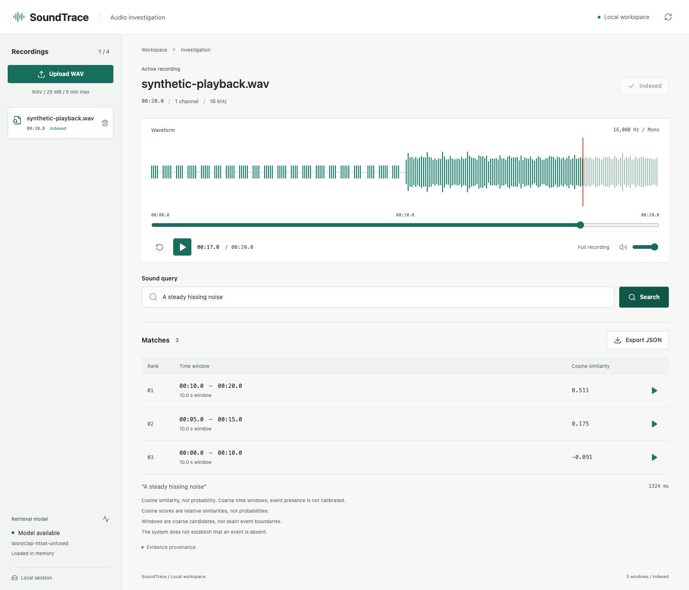
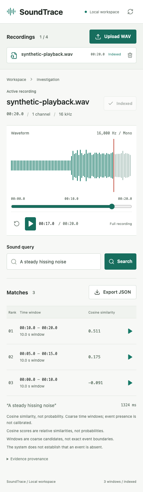

# SoundTrace

Find what you heard: an evidence-first audio search workbench.

**Working prototype / work in progress.** Search a recording for sounds described
in natural language, inspect the ranked time windows, listen to the evidence
and export its provenance. The first local workflow works end to end; real-world
retrieval evaluation and temporal refinement are the next research milestone.

Python / FastAPI / PyTorch / CLAP / React / TypeScript / WaveSurfer



Actual local CLAP results on an original synthetic tones/noise fixture. This
demonstrates the workflow, not natural-sound accuracy. [Mobile view](docs/media/mobile.png)
and [milestone evidence](docs/progress.md).

<details>
<summary>Mobile screenshot</summary>



</details>

## Current scope

| Available now | Still planned |
| --- | --- |
| Validated WAV upload and in-memory recording management | Persistent collections and public hosting |
| Local CPU CLAP audio/text embeddings | Real-audio retrieval benchmark and latency/memory profiling |
| Ranked candidate windows with cosine scores | Temporal refinement and calibrated abstention |
| Waveform, seeking and bounded interval playback | Spectrogram inspection and audio-example search |
| JSON evidence with audio hash and model revision | Read-only MCP tools and evaluated investigator agent |

The model is pretrained; this milestone does not train a new model or establish
an improvement over CLAP. Screenshots show real execution, not mock search data.

**Explore:** [Demo walkthrough](docs/demo.md) / [Architecture](docs/architecture.md) /
[Development](CONTRIBUTING.md) / [Documentation index](docs/README.md)

## Run locally

Prerequisites: Python 3.12, `uv`, Node.js 24 and npm. Run from the repository root:

```sh
uv sync --locked --extra dev --extra model
source .venv/bin/activate
python -m soundtrace.prepare_model
uvicorn soundtrace.api:app --host 127.0.0.1 --port 8012
```

In another terminal, starting from the repository root:

```sh
cd apps/web
npm ci
npm run dev -- --host 127.0.0.1 --port 5182
```

Open http://127.0.0.1:5182. Upload a WAV recording you have permission to use,
index it, then search for a sound. Preparing the model downloads the official
checkpoint once and records its exact revision. API requests use local files
only and never trigger downloads. Model setup is optional for upload/playback.

The service stores at most four recordings in memory until restart. It is a
single-user loopback tool, not an authenticated public upload service. Uploads
are limited to 25 MB/five minutes, one/two channels and 8-96 kHz. Raw audio and
model weights remain outside Git. There is no cloud audio upload or paid API.

## What the results mean

CLAP maps text and audio windows into a shared embedding space. SoundTrace ranks
ten-second windows with a five-second hop and a final aligned window. Scores
are cosine similarities, not probabilities or calibrated confidence. Returned
intervals are coarse candidates, not exact event annotations. A ranking does
not establish that a requested event exists or is absent.

The pretrained model is an established component, not our novel algorithm. The
project's intended contribution is inspectable evidence, robust temporal
retrieval evaluation and usable investigation workflows. See the
[design](docs/design.md) and [implementation checklist](docs/plan.md).

## Testing

From the repository root with the Python environment activated:

```sh
pytest
ruff check .
ruff format --check .
mypy src
cd apps/web
npm run check
npm test -- --run
npm run build
```

Unit/API tests use deterministic test embeddings to check contracts; they do
not measure CLAP quality. `scripts/make_playback_fixture.py` creates original
synthetic tones/noise for playback QA only. Do not report that fixture as a
real-world accuracy benchmark.

For a local real-model smoke test after preparing the checkpoint:

Run these commands from the repository root, not `apps/web`:

```sh
python scripts/make_playback_fixture.py
python scripts/smoke_model.py
```

The generated recording contains original synthetic tones and noise, not a
real-world evaluation set. The smoke report is written to ignored `output/`.

## Data and model sources

- [CLAP model card](https://huggingface.co/laion/clap-htsat-unfused): model licence
  is listed as Apache-2.0; record checkpoint revision with every real run.
- [DCASE audio moment retrieval](https://dcase.community/challenge2026/task-audio-moment-retrieval-from-long-audio): task, datasets and temporal evaluation references.
- [Clotho 2.1](https://zenodo.org/records/4783391): source audio has per-file
  terms; caption terms differ. No third-party audio is redistributed here.

An official dataset card alone does not clear all source-audio rights. Public
demo recordings require explicit provenance and redistribution review.
