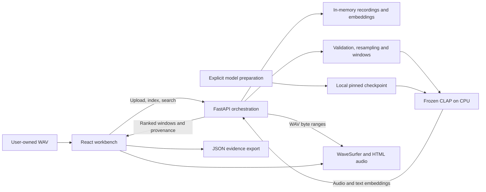

# Architecture

## System boundary

SoundTrace is a single-user local audio retrieval workbench, not a hosted
multi-tenant service. A React browser client talks to a FastAPI process through
Vite's `/api` proxy. The API keeps validated audio, waveform summaries and
embeddings in memory. A frozen CLAP provider runs on CPU and reads an explicitly
prepared local checkpoint. No language model or investigator agent participates
in the current search path.

The download path is separate from request handling. All runtime components
above run on the user's machine; JSON export is a browser download.

| Component | Responsibility | Location |
| --- | --- | --- |
| Workbench | Upload, recording selection, query and evidence presentation | `apps/web/src/App.tsx` |
| Client state | Abort stale requests, coordinate indexing and selection | `apps/web/src/useWorkbench.ts` |
| Player | WaveSurfer waveform, HTML audio transport and interval boundaries | `apps/web/src/Player.tsx` |
| HTTP adapter | Typed requests and error handling | `apps/web/src/api.ts` |
| API/store | Admission limits, recording lifecycle, indexing and search orchestration | `src/soundtrace/api.py` |
| Audio/retrieval core | WAV validation, window bounds, peaks and cosine ranking | `src/soundtrace/core.py` |
| Provider contract | Embedding interface and recording metadata types | `src/soundtrace/contracts.py` |
| CLAP adapter | Local-only lazy loading and batched inference | `src/soundtrace/model.py` |
| Model preparation | Explicit download with pinned revision manifest | `src/soundtrace/prepare_model.py` |

## Upload and playback

1. The client sends WAV bytes and an encoded filename to `POST /api/recordings`.
2. The API admits one upload at a time, checks byte/capacity bounds, decodes the
   content and validates duration, channels, sample rate and finite amplitudes.
3. SHA-256 identifies the uploaded bytes. Metadata includes real waveform peaks;
   the original bytes and mono samples stay in the in-memory store.
4. The browser plays the original validated WAV via the recording's audio URL.
   Single byte-range requests return `206` for seeking; unsatisfiable ranges
   return `416`. Unsupported range sets fall back to the complete response.
5. Selecting a result starts its candidate interval. Manual seeking clears the
   selected interval rather than retaining a misleading match highlight.

## Index and search

1. Explicit indexing resamples mono audio to 48 kHz with polyphase resampling.
2. Ten-second windows use a five-second hop and a final end-aligned window.
   Short recordings use their full duration. Windows are embedded in batches of
   two with the frozen CPU CLAP provider.
3. Normalised embeddings are stored against the recording identity. A query is
   embedded through CLAP's text encoder, then ranked by cosine similarity.
4. The response contains candidate timestamps, scores, audio SHA-256, exact model
   revision and limitations. JSON export preserves this response as evidence.

The windows overlap. A high score is not a probability, calibrated detection,
proof of event presence or a precise event boundary. Absence cannot be inferred
from the ranking. No vector database is needed for the current bounded store.

## Concurrency and lifecycle

The store lock protects short state operations, not inference. A separate
nonblocking model gate serialises index/search; unrelated playback, listing and
deletion remain available. Busy operations return explicit errors. Before
publishing inference results, the API checks that the original recording object
is still stored, preventing stale results after deletion and reupload.

The upload gate bounds concurrent decode work. At most four recordings, 25 MB
each and five minutes each, are accepted. Supported WAV input is one/two
channels at 8-96 kHz. Restarting the service discards recordings and indexes.
The client aborts superseded requests and ignores stale responses.

## Model lifecycle

`python -m soundtrace.prepare_model` is the only normal download path. It records
the upstream checkpoint revision after preparation. Requests never download a
model. The provider loads lazily with local-files-only settings. Missing or
failed model setup is visible in health and disables retrieval; upload/playback
can still work. Readiness checks are not a checkpoint-integrity certificate.

## Deployment and trust

Bind the API and UI to loopback. There is no authentication, durable storage,
tenant isolation or production ingress configuration. Do not expose this
prototype directly to the Internet. Logs and exported evidence can contain user
filenames or queries; review them before sharing. No uploaded recordings or
checkpoint weights are committed. Research audio requires per-file rights review.

## Verification boundary

Unit/API tests cover deterministic contracts and edge cases; they do not measure
semantic quality. A separate real-model smoke script proves that the installed
checkpoint executes. Chrome QA verifies actual playback, waveform rendering and
responsive layouts. The [milestone log](progress.md) distinguishes this evidence
from the planned [real-data evaluation](data-and-evaluation.md).

MCP, agents, multiscale retrieval and model training remain roadmap items, not
hidden services in this architecture.
